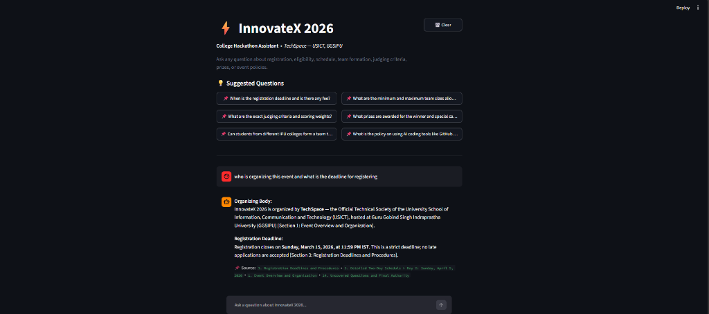

# ⚡ InnovateX 2026 — College Hackathon Assistant



A lightweight **Retrieval-Augmented Generation (RAG)** assistant built for **InnovateX 2026** — an inter-college hackathon hosted at **USICT, GGSIPU** and organized by the **TechSpace** technical society.

The chatbot answers student questions regarding registration, eligibility, schedule, prizes, judging criteria, and event policies strictly using the official markdown event rulebook (`event_rulebook.md`).

---

## 🚀 Features

- **Grounded & Factual:** Answers strictly from `event_rulebook.md` — no hallucinations or invented rules.
- **Out-of-Scope Filtering:** Rejects unrelated questions with friendly guidance.
- **Fast & In-Memory:** Semantic vector search with NumPy cosine similarity — no paid vector database needed.
- **Zero Cost Stack:** Uses local embeddings (`all-MiniLM-L6-v2`) and free OpenRouter chat completions.
- **Source Citations:** Displays the exact rulebook sections referenced for each answer.

---

## 🛠️ Tech Stack

- **Python 3.10+**
- **Streamlit** (Clean, minimalist UI)
- **Sentence-Transformers** (`all-MiniLM-L6-v2` for 384-d embeddings)
- **NumPy** (Cosine similarity calculation)
- **OpenRouter API** (`nvidia/nemotron-3-ultra-550b-a55b:free`)
- **Pytest** (Automated unit test suite)

---

## 📦 Quick Setup

### 1. Clone the Repository
```bash
git clone https://github.com/ChirjivSingh/RAG-CHATBOT-FOR-COLLEGE-EVENT.git
cd RAG-CHATBOT-FOR-COLLEGE-EVENT
```

### 2. Create and Activate Virtual Environment
**Windows:**
```powershell
python -m venv venv
.\venv\Scripts\Activate.ps1
```
**macOS / Linux:**
```bash
python3 -m venv venv
source venv/bin/activate
```

### 3. Install Requirements
```bash
pip install -r requirements.txt
```

### 4. Configure Environment Variables
Create a `.env` file in the project root:
```ini
OPENROUTER_API_KEY=your_openrouter_api_key_here
OPENROUTER_MODEL=nvidia/nemotron-3-ultra-550b-a55b:free
```
*(Get a free API key at [openrouter.ai/keys](https://openrouter.ai/keys))*.

### 5. Run the Application
```bash
streamlit run app.py
```
Open `http://localhost:8501` in your browser.

---

## 🧪 Run Tests

Run the full automated test suite (all tests use mocked LLM calls so no API quota is consumed):
```bash
python -m pytest -v tests/test_rag.py
```

---

## 📁 Project Structure

```
├── app.py                # Streamlit chat interface
├── rag.py                # Document chunking, embeddings & retrieval
├── llm.py                # OpenRouter integration & strict grounding
├── event_rulebook.md     # Official mock event rulebook
├── requirements.txt      # Python dependencies
├── .env.example          # Template for environment variables
├── assets/demo.png       # Demo screenshot
└── tests/test_rag.py     # Unit test suite (17 passed tests)
```

---

## 👥 Organizers

- **Society:** TechSpace — The Official Technical Society of USICT
- **Institution:** University School of Information, Communication and Technology (USICT), GGSIPU, Dwarka, New Delhi.
